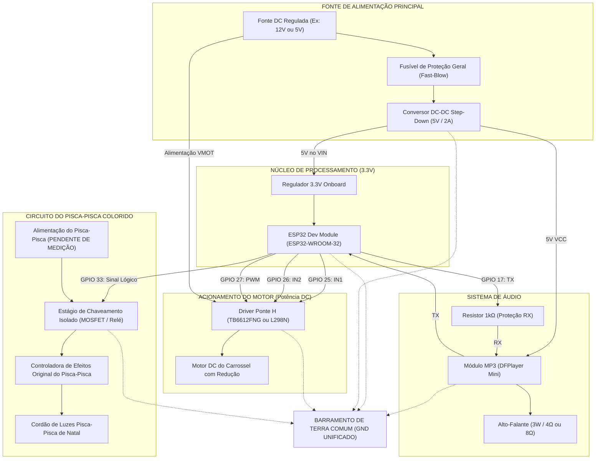

# ESQUEMA ELÉTRICO E ARQUITETURA DE HARDWARE

## 1. Visão Geral da Arquitetura Elétrica



---

## 2. Diagrama Conceitual Detalhado (Conexões Físicas)

```text
               +----------------------------------------------------+
               |                FONTE DE ALIMENTAÇÃO                |
               |       (Exemplo com entrada 12V DC e Step-Down 5V)  |
               +-------------------------+--------------------------+
                                         |
                       +-----------------+-----------------+
                       | +12V (Potência) | GND             | +5V (Lógica)
                       |                 |                 |
                       v                 v                 v
                 +-----------+     +-----------+     +-----------+
                 | DRIVER    |     | BARRAMENTO|     | ESP32 DEV |
                 | PONTE H   |     | COMUM GND |     | MODULE    |
                 +-----------+     +-----------+     +-----------+
                 | VMOT (+12)|<----+     ^           | VIN (+5V) |<-- +5V
                 | GND       +-----------+           | GND       +--+ GND
                 | IN1       |<----------------------| GPIO 25   |  |
                 | IN2       |<----------------------| GPIO 26   |  |
                 | ENA (PWM) |<----------------------| GPIO 27   |  |
                 | OUT1,OUT2 |                       |           |  |
                 +-----+-----+                       |           |  |
                       |                             |           |  |
                 +-----v-----+                       |           |  |
                 | MOTOR DC  |                       |           |  |
                 | CARROSSEL |                       |           |  |
                 +-----------+                       |           |  |
                                                     |           |  |
                 +-----------+                       |           |  |
                 | DFPLAYER  |                       |           |  |
                 | MINI      |                       |           |  |
                 +-----------+                       |           |  |
                 | VCC (+5V) |<-------------------------------------+ +5V
                 | GND       +--------------------------------------+ GND
                 | RX        |<---[ Resistor 1kΩ ]---| GPIO 17   |
                 | TX        |---------------------->| GPIO 16   |
                 | SPK1,SPK2 |                       |           |
                 +-----+-----+                       |           |
                       |                             |           |
                 +-----v-----+                       |           |
                 | ALTO-     |                       |           |
                 | FALANTE   |                       |           |
                 +-----------+                       |           |
                                                     |           |
                 +-----------------------+           |           |
                 | ESTÁGIO DE POTÊNCIA   |           |           |
                 | DO PISCA-PISCA        |           |           |
                 | (Circuito Conceitual) |           |           |
                 +-----------------------+           |           |
                 | IN / GATE             |<----------| GPIO 33   |
                 | GND LÓGICO            +--------------------------+ GND
                 | V_IN CARGA (PENDENTE) |<-- Fonte Externa do Pisca
                 | V_OUT CHAVEADO        |---> Para a Controladora Original do Pisca
                 +-----------------------+
```

---

## 3. Circuito do Pisca-Pisca de Natal Colorido

> ⚠️ **AVISO FUNDAMENTAL:**
> A tensão e corrente do pisca-pisca selecionado permanecem **PENDENTES DE IDENTIFICAÇÃO**.
> **NUNCA tente ligar os fios do pisca-pisca diretamente a nenhum pino do ESP32.**
> O acionamento preserva integralmente a caixinha controladora original com os efeitos de cores natalinos.

Apresentamos abaixo as duas alternativas de engenharia:

### Alternativa A: Pisca-Pisca de Baixa Tensão (5V ou 12V DC) - **[ALTAMENTE RECOMENDADA]**

Para brinquedos infantis, conjuntos de iluminação de **5V (USB) ou 12V DC** são infinitamente mais seguros contra choques e superaquecimento.

```text
ESP32 GPIO 33 ---> [ Resistor 220Ω ] ---> Gate (G) do MOSFET IRLZ44N (N-Channel Logic Level)
                                             |
                                    [ Resistor 10kΩ Pull-Down ]
                                             |
                                            GND

Fonte do Pisca (+) -----------------------------------> (+) Entrada da Caixinha do Pisca
Fonte do Pisca (-) ----> Drain (D) do MOSFET
                         Source (S) do MOSFET ---------> (-) GND da Fonte
```

* **Vantagens:** Chaveamento 100% eletrônico, silencioso, sem desgaste mecânico e tensão intrinsecamente segura para crianças.

---

### Alternativa B: Pisca-Pisca de Rede Elétrica (127V / 220V AC) - **[CONDICIONADA A PROTOCOLOS ESTRITOS]**

Caso o modelo de pisca-pisca adquirido seja alimentado exclusivamente pela tomada residencial (127V/220V AC):

```text
ESP32 GPIO 33 ---> Entrada IN do Módulo Relé Optoisolado (com acoplador óptico 5kV)
ESP32 GND     ---> GND do Módulo Relé
Fonte 5V      ---> VCC / JD-VCC do Módulo Relé (com jumper retirado para isolação galvânica total)

Tomada AC (Fase) ----> Fusível de Linha (1A) ----> Terminal COM do Relé
                                                   Terminal NA (Normalmente Aberto) ---> Plugue do Pisca
Tomada AC (Neutro) --------------------------------------------------------------------> Plugue do Pisca
```

**EXIGÊNCIAS OBRIGATÓRIAS DE SEGURANÇA PARA A VERSÃO AC:**
1. A montagem desta parte deve ser realizada por profissional técnico habilitado.
2. A fiação de alta tensão AC deve ficar contida em **gabinete plástico fechado com parafusos anti-violação**, completamente inacessível a mãos de crianças.
3. Deve ser utilizado isolamento duplo, prensa-cabos e tubos termo-retráteis em todas as emendas.
4. Jamais ligar o fio Neutro ou Fase no plano de terra (GND) do ESP32.

---

## 4. Circuito do Driver de Motor

O motor responsável pela rotação do carrossel exige alto torque de partida (inércia do brinquedo e peso dos bonecos).

* **Driver Recomendado:** TB6612FNG (eficiência de 90% via MOSFETs internos, menor aquecimento) ou L298N (com dissipador de calor e aletas metálicas).
* **Proteção:** Diodos Schottky de roda-livre (flyback) para absorver transientes indutivos gerados pelo motor na frenagem.
* **Filtro:** Capacitor cerâmico de 100nF soldado diretamente entre os dois terminais do motor DC para eliminar ruídos eletromagnéticos (EMI) que possam interferir no Wi-Fi/Bluetooth do ESP32.
